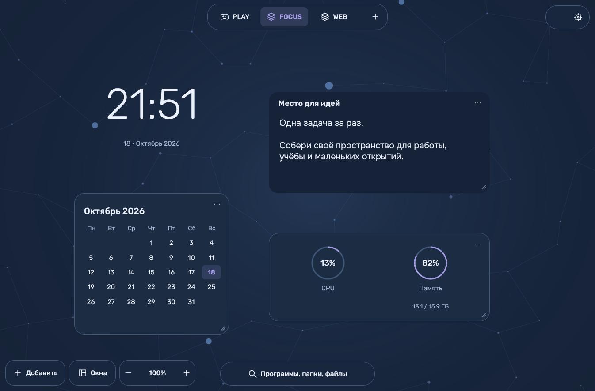
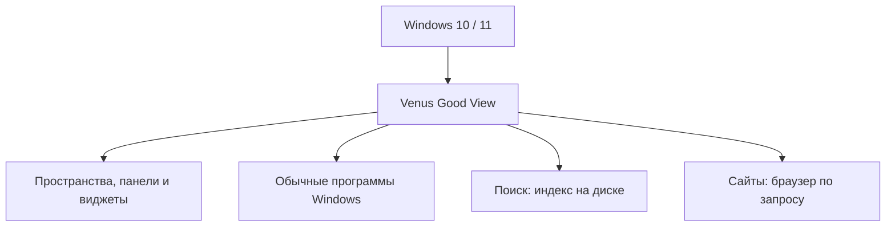

# Venus Good View

**Свой рабочий стол поверх Windows.** Пространства для работы, игр и идей, спокойный фон со связями между узлами, собственные панели и виджеты.

Проект вдохновлён кастомными рабочими столами **Arch Linux**, Hyprland и культурой *ricing*: когда окружение собирают под себя. Здесь та же идея свободы и минимализма, с обычными программами и играми Windows.

[**Скачать 0.8.11**](https://github.com/MantyZOR/VenusGoodView/releases/tag/v0.8.11) · [Все релизы](https://github.com/MantyZOR/VenusGoodView/releases) · [Сообщить о проблеме](https://github.com/MantyZOR/VenusGoodView/issues)

На изображении — настоящий интерфейс 0.8.11 с демонстрационной раскладкой. Виджеты, расположение и оформление можно менять.

## Что умеет

- **Разные пространства.** Работа, игры, сайты или своё полотно; у каждого свои карточки и оформление. Настройки сохраняются после перезагрузки.
- **Собственные панели.** Навигация, поиск, открытые окна и фоновые приложения. Панели можно перемещать, разворачивать и менять их скругление.
- **Окна на нескольких мониторах.** Обычная панель значков или кольцо из сегментов; каждая панель показывает окна своего монитора.
- **Быстрый поиск.** Программы, файлы и папки. Уже открытое приложение можно вернуть из поиска.
- **Виджеты.** Заметки, часы, календарь, CPU, память, диски и сеть; ярлыки программ и папок; сайты прямо на полотне.
- **Оформление под себя.** Тёмная, тёплая светлая и холодная светлая темы, акценты, размеры текста. Шрифты Rubik + Onest поддерживают русский и английский.

В 0.8.11 весь сегмент кольца стал кликабельным. При наведении он слегка выдвигается, увеличивается и меняет оттенок. Номер страницы стоит по центру, ниже — «1 из 2».

## Установить и начать

1. Открой [релиз 0.8.11](https://github.com/MantyZOR/VenusGoodView/releases/tag/v0.8.11) и скачай установщик `VenusGoodView-0.8.11-Setup.exe`.
2. Установи программу и запусти её из меню «Пуск». У этой версии внутреннее имя и пункт меню пока **WindowsGoodView**.
3. Выбери пространство, добавь виджеты и настрой панели через кнопку настроек.

Для запуска из папки есть `VenusGoodView-0.8.11-Portable.zip`: распакуй архив и открой `WindowsGoodView.exe`. Индекс и настройки создаются при использовании, в архиве их нет.

Для встроенных сайтов нужен **Microsoft Edge WebView2 Runtime**. Если он отсутствует, установщик предложит его установить через интернет. Остальные части оболочки работают без встроенного браузера.

Вернуться к привычному рабочему столу можно через **Настройки → Вернуться к рабочему столу Windows**. **Ctrl + Q** в интерфейсе завершает программу. Независимый аварийный выход — **Ctrl + Alt + Shift + Space**.

| Сочетание | Действие |
| --- | --- |
| Ctrl + Alt + Space | Поиск программ и файлов |
| Ctrl + Alt + D | Вернуться на полотно |
| Ctrl + Alt + 1…4 | Первые четыре пространства |
| Ctrl + N на полотне | Добавить заметку |
| Esc | Закрыть меню |

## Требования и место на диске

| Что | Ориентир |
| --- | --- |
| Система | Windows 10 версии 1809 или новее / Windows 11, **x64** |
| Экраны | Один или несколько мониторов; разрешение не зафиксировано |
| Загрузка | Установщик около **4,6 МиБ**, сам EXE около **2,4 МиБ** |
| Базовая установка | Закладывай **20 МиБ свободного места** без индекса файлов и данных сайтов |
| Файловый индекс | В измеренном примере около **73 МиБ на 514 тыс. записей** |
| Встроенные сайты | Дополнительное место для WebView2 и его браузерных данных |

Индекс хранится **в файле на диске**. Он содержит имена и расположение файлов, без содержимого документов. Размер зависит от количества записей и длины имён; на миллион записей с похожими именами ориентир составляет около **140–160 МиБ**. Это оценка, не предел. На время построения оставляй запас свободного места в несколько раз больше итоговой базы.

Для полного локального NTFS-диска доступен быстрый режим **MFT**. Ему нужен отдельный запрос администратора; сама оболочка работает с обычными правами. Для других файловых систем и выбранных папок остаётся обычный обход. Папки и глубина поиска меняются в настройках индекса.

### Сколько ест ресурсов

Ориентир из короткого замера версии **0.8.9** на двух мониторах: около **80 МиБ рабочего набора** оболочки вместе с помощником восстановления; собственная выделенная память — около **52 МиБ**. Средняя нагрузка на весь CPU в том спокойном сеансе была около **0,02%**.

Это пример с одного компьютера, без живых сайтов, индексации и движения фона. Для **0.8.11 отдельный замер не проводился**. Число мониторов, виджеты и открытые сайты меняют расход; обычные приложения и игры используют свою память отдельно. Подтверждённого минимального объёма ОЗУ для всего компьютера пока нет.

Для экономного режима оставь фон статичным, отключи секунды у часов и используй выгрузку скрытых веб-карточек. Короткий эффект наведения на сегмент останавливается после перехода. [Подробнее о замерах и индексе](docs/RESOURCES.md).

## Как устроено внутри

Основной интерфейс написан на **C++ и штатных графических средствах Windows**. Для панелей и часов браузер не нужен; WebView2 появляется при открытии сайта. Индекс файлов использует SQLite и ограниченный кеш, весь список файлов в оперативную память не загружается. Отдельный небольшой помощник отвечает за аварийный возврат к Windows.

Windows и её программы продолжают работать под оболочкой. Настройки установленной версии лежат в `%LOCALAPPDATA%\WindowsGoodView`, переносимой — в папке `data` рядом с EXE. Удаление программы сохраняет профиль для повторной установки.

[Устройство исходников](docs/ARCHITECTURE.md) · [Собрать самостоятельно](docs/BUILD.md) · [Что нового](CHANGELOG.md) · [Использованные компоненты и их лицензии](resources/THIRD_PARTY_NOTICES.txt)
